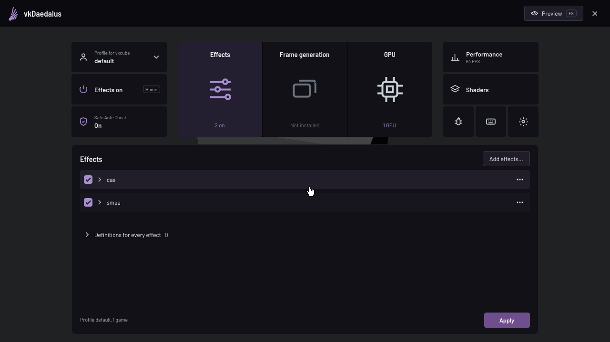
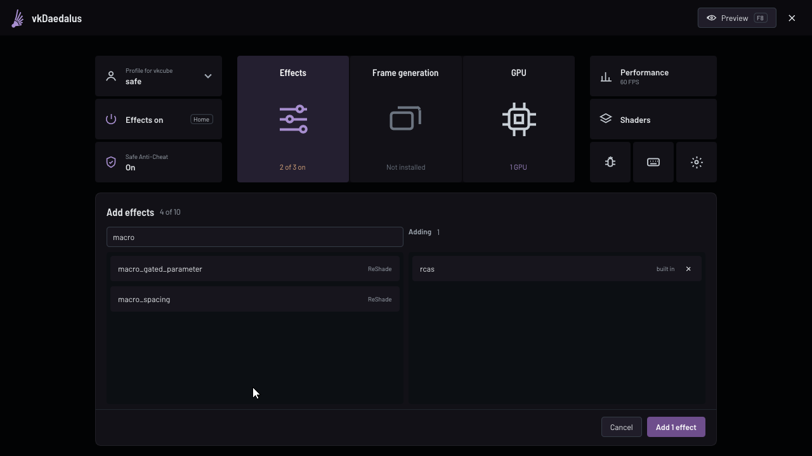
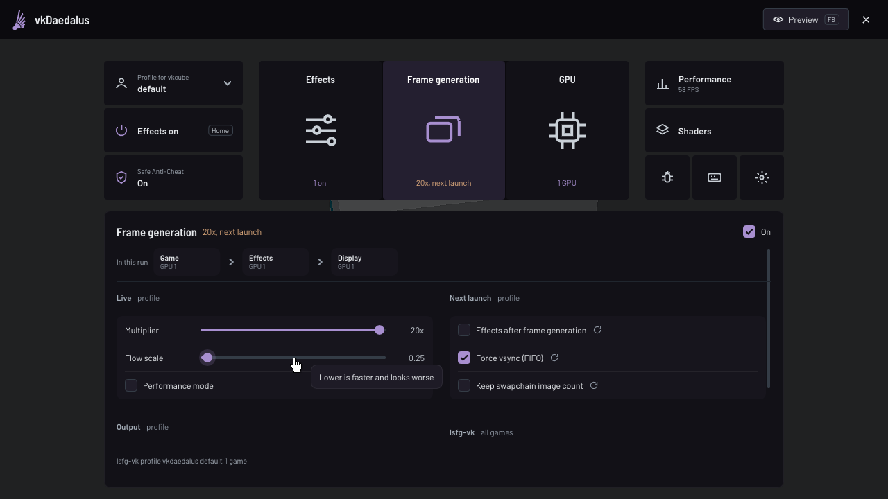
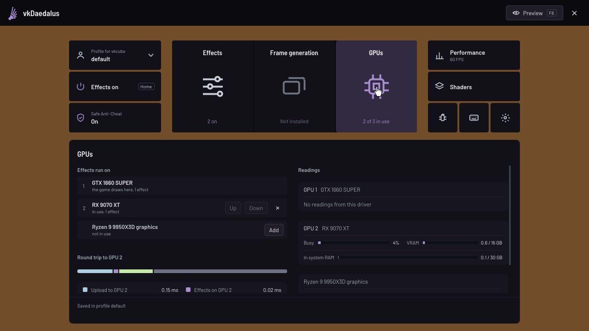
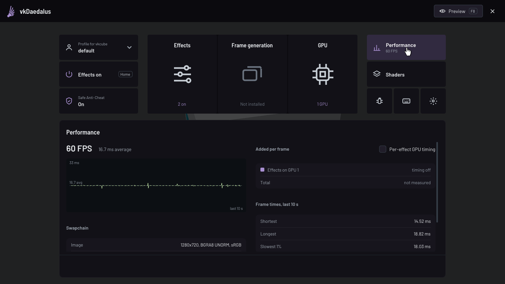
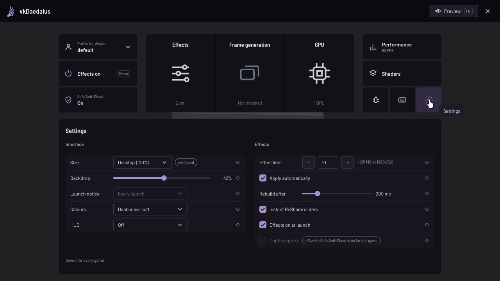

# vkDaedalus

<!-- BEGIN generated:badges -->
[](https://github.com/Daaboulex/vkDaedalus/actions/workflows/ci.yml)
[](https://nixos.org)
[](./LICENSE)
<!-- END generated:badges -->

A Vulkan post-processing layer with an in-game overlay: add, tune and reorder ReShade and built-in
effects while the game runs, on X11 and Wayland, natively or under Wine and Proton. It also switches
lsfg-vk frame generation per game, runs effects on a second GPU and shows what it adds to each frame.

In Steam, set a game's launch options to `vkdaedalus-run %command%`, start the game and press `End`.

| Effects | Add effects | Frame generation |
|---|---|---|
|  |  |  |
| **GPU** | **Performance** | **Settings** |
|  |  |  |

The screenshots are real frames from the test suite, a game on an NVIDIA GeForce GTX 1660 SUPER with an
AMD Radeon RX 9070 XT as its second GPU (2026-10-25).

## Features

- **Overlay** (`End`): see-through over the game, with opaque tiles and cards:
  the profile, the effects switch and Safe Anti-Cheat; Effects, Frame
  generation, GPUs, Performance, Shaders, Debug, Keys and Settings. Hold `F8`
  or Preview to see the game with its effects while the overlay stays open and
  the game still gets no input. It follows the desktop's scale (the Wayland
  output the game is on, or X11's Xft.dpi, or a size chosen in Settings), turns
  compact on 4:3, portrait and small displays so its text stays readable, closes
  with its key or its close button, and draws its own pointer. No action is tied
  to Esc, so Esc can be bound like any key. Changes apply live; a setting read
  only when a game starts carries a restart mark.
- **Effects**: CAS, RCAS, DLS, FXAA, SMAA, Deband and LUT built in, and ReShade
  FX shaders compiled by the upstream ReShade compiler. Add, remove, reorder by
  dragging, run several instances (`cas`, `cas.1`), tune every parameter type,
  edit an effect's preprocessor definitions and ReShade's global ones.
- **Profiles shared between games**: each game, detected from its executable (the
  `.exe` under Wine and Proton), runs one, and `none` keeps the layer out of a program.
- **Shader manager**: point it at shader packs; it finds their `Shaders/` and
  `Textures/` folders and test-compiles every shader.
- **Frame generation** through lsfg-vk, switched and tuned per game from the
  overlay, with effects before or after it per game.
- **Multi-GPU offload**: effects can run on another GPU; the GPUs page also
  shows every GPU's usage and memory.
- **Performance card**: frame statistics and what vkDaedalus adds to a frame, an
  estimate marked with a ~, every formula in [LATENCY.md](LATENCY.md): FPS over
  the last second, the rest over the last 10 seconds, the display's refresh where
  the compositor reports it. The Debug card's Frame path tab lists which figures
  this run measures and which it estimates.
- **HUD**: FPS and, by choice, frame time, slowest 1% and effects time at the top
  left while the overlay is closed, in Steam's levels (Settings, Interface); off,
  it draws nothing.
- **Settings say what you changed**: a filled dot at a row's end, in Settings
  and on every effect parameter, marks a value changed from its default, which
  its tooltip names, and a click sets it back.
- **Nine colour schemes**, Daaboulex soft by default, each holding text, warnings,
  errors and success at 4.5:1 on every surface (Settings, Interface, Colours).
- **Logs and a report**: the log also goes to
  `$XDG_STATE_HOME/vkdaedalus/vkdaedalus.log`, kept under 8 MiB, lsfg-vk's beside
  it, and Export on the Debug card's Log tab writes one report, both logs, the
  GPUs, the layer order and the profile, to your download folder. The Log tab
  keeps warnings and errors from the start and the rest from when the card
  opened.
- **Safe Anti-Cheat**, on for every game by default: no effect reads depth.
- **The game gets no input while the overlay is open**: the input hook
  `vkdaedalus-run` preloads holds the game's keys, buttons and motion on Wayland
  and X11, with no grab, so a game holding the pointer is held too; a release
  whose press reached the game still does, so a held key does not stick. Started
  without `vkdaedalus-run`, an X11 game gets a keyboard and pointer grab instead.

<!-- BEGIN generated:upstream -->
## Upstream

| | |
|---|---|
| **Project** | Fork of [DadSchoorse/vkBasalt](https://github.com/DadSchoorse/vkBasalt) via [Boux/vkBasalt_overlay](https://github.com/Boux/vkBasalt_overlay) |
| **License** | zlib |
| **Tracked** | Not tracked. Both upstreams are dormant; this fork is the continuation |

<!-- END generated:upstream -->

Until October 2026 this was vkBasalt Overlay. It read `ENABLE_VKBASALT` and the `VKBASALT_` variables
that upstream vkBasalt reads too, and Proton-CachyOS bundles upstream vkBasalt, so both could run in one
game; the new name ends that. It is written largely with AI assistance and tested on real GPUs by
`nix run .#live` ([TESTING.md](TESTING.md)). A heavy shader on a game already at full GPU load can still
stall it.

<!-- BEGIN generated:installation -->
## Installation

Add vkDaedalus as a flake input and its overlay:

```nix
{
  inputs.vkdaedalus = {
    url = "github:Daaboulex/vkDaedalus";
    inputs.nixpkgs.follows = "nixpkgs";
  };
}
```

```nix
nixpkgs.overlays = [ inputs.vkdaedalus.overlays.default ];
```

<!-- END generated:installation -->

[Install](docs/install.md) covers the 32-bit build, Arch and CachyOS and other distributions.

## Documentation

| Page | What it covers |
|---|---|
| [Install](docs/install.md) | NixOS, Arch and CachyOS, meson |
| [Use vkDaedalus in a game](docs/use.md) | Steam, profiles, other launchers |
| [Keys](docs/keys.md) | the default keys and how to change them |
| [Configuration](docs/configuration.md) | every file vkDaedalus keeps and who writes it |
| [Environment variables](docs/environment.md) | every variable it reads |
| [ReShade shaders](docs/shaders.md) | shader packs, what runs, the compiled effects cache |
| [Frame generation](docs/frame-generation.md) | lsfg-vk from the overlay, effects before or after it |
| [Run effects on a second GPU](docs/second-gpu.md) | moving rows to another GPU and its limits |
| [Safe Anti-Cheat](docs/safe-anti-cheat.md) | what it turns off and what it cannot do |
| [Limitations](docs/limitations.md) | known limits and what applies only at the next start |
| [How it works](docs/how-it-works.md) | the frame, input, layer order, a second GPU, failures |
| [Development](docs/development.md) | building and testing |
| [TESTING.md](TESTING.md), [LATENCY.md](LATENCY.md), [SHADER-COMPATIBILITY.md](SHADER-COMPATIBILITY.md) | what is tested, every timing formula, every shader pack's result |

## Credits

- **vkBasalt** by [@DadSchoorse](https://github.com/DadSchoorse) (Georg Lehmann), [zlib license](LICENSE)
- **vkBasalt Overlay** by [@Boux](https://github.com/Boux/vkBasalt_overlay): the ImGui overlay, effect management and shader manager
- **vkDaedalus** by [@Daaboulex](https://github.com/Daaboulex/vkDaedalus)
- **ReShade**'s shader compiler by [@crosire](https://github.com/crosire)
- **Dear ImGui** by [@ocornut](https://github.com/ocornut)
- **lsfg-vk** by [@PancakeTAS](https://github.com/PancakeTAS)

<!-- BEGIN generated:footer -->
<!-- END generated:footer -->
